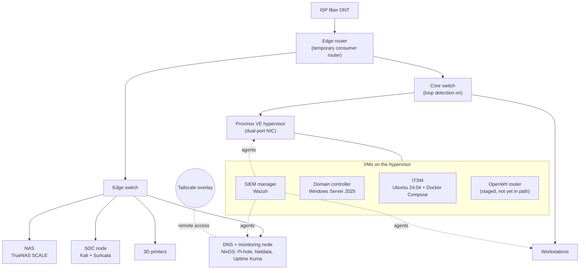

# homelab-public

> Part of **TechPanthéon**: purple-team homelab, detection engineering, and 3D-printed hardware.

I run a self-hosted lab at home that I treat like a small production environment. It has a Proxmox VE hypervisor, a SIEM with agents across the lab, an Active Directory domain, a ticketing system, and a two-switch network, and I use it to practice SOC work, detection engineering and infrastructure automation on real systems instead of tutorials.

This repo is the public side of that lab. The real configs, addressing and secrets live in a private repo (git-crypt encrypted) and never come here. What is here is written clean for publishing.

## Links
- **Website:** https://www.pantheonoftech.com
- **Linktree:** https://linktr.ee/pantheonoftech

## The lab

Host names and addresses are left out on purpose. In the private repo every node has its own doc, and configs are tracked as code.

| Layer | What runs there |
|-------|-----------------|
| Network | Temporary edge router while an OpenWrt VM is staged to replace it, separate edge and core switches, Tailscale overlay for remote access |
| Compute | Proxmox VE hypervisor with a dual-port Intel NIC, running the SIEM, directory, ITSM and router VMs, with snapshots before patching |
| Security monitoring | Wazuh manager with agents on Linux, Windows and the hypervisor itself, agent groups for Linux servers, Windows endpoints and the hypervisor, and Suricata on a Kali node |
| Identity | Windows Server 2025 domain controller with AD DS and DNS, managed remotely with RSAT |
| DNS and uptime | NixOS node running Pi-hole, Netdata and Uptime Kuma |
| IT service management | GLPI 11 on MariaDB 11.4 behind a Caddy reverse proxy (Docker Compose), with inventory agents reporting in |
| Storage | TrueNAS SCALE NAS |
| Knowledge and config | Obsidian for notes and runbooks, git for configs, private repo encrypted with git-crypt |
| Fabrication | FDM printer commissioned from a full EEPROM dump, printed 10" racks, parts generated in code |

## Problems I have worked through

These come from the [changelog](CHANGELOG.md), which has the full history.

| Problem | What I did |
|---------|-----------|
| Bridge loop after adding a dual-port NIC to the hypervisor: both ports ended up on the same switch while the router VM was bridging them | Found the cause, fixed the cabling and turned on loopback detection on the core switch |
| A subnet migration left every SIEM agent pointed at the old manager address | Repointed each one with the method its platform needed, including a NixOS host whose containerized agent needed both its environment and its mounted config changed |
| Containerized SIEM agent would not start after enrollment | Traced it to files left owned by root after seeding the container, fixed ownership and restarted it |
| SIEM flagged 1 critical and 22 high findings on the hypervisor | Checked them against Debian's security tracker with debsecan, showed the critical was a false positive caused by backport version numbering, and sorted the rest into fixed, no-fix-yet and accept-the-risk |
| GLPI behind Caddy failed TLS on SNI | Added an explicit SAN and set a default SNI |
| Inventory agent MSI ignored its install properties without any error | Configured the agents by hand instead |
| About 2,600 SIEM alerts right after patching the domain controller | Confirmed they came from update staging paths, treated them as false positives and moved tuning into the baseline work |
| Active Directory SRV records stopped resolving | Re-registered them, restarted Netlogon, confirmed a clean dcdiag |

## Code in this repo

| Path | Contents |
|------|----------|
| [`Code/`](Code/README.md) | PowerShell and Python tooling: a shared profile with SOC triage helpers, **Faire** (scheduled watch scripts that alert through the Windows event log), **Glas** (AES-256/HMAC and DPAPI secrets), **Seala** (script header stamper), **Cuairt** (read-only lab sweep with Wazuh agent state) |
| [`CHANGELOG.md`](CHANGELOG.md) | Sanitized mirror of the private engineering log |

Each tool folder has its own README with install, usage and security notes.

## How I run it

Everything is self-hosted and local first, with no telemetry. I run llama.cpp locally instead of using cloud inference. Git owns configuration and Obsidian owns knowledge. Anything destructive gets a read-only pass first and an explicit confirmation before it runs, and if something can be automated, I automate it.

## Sanitization
Internal addressing is swapped for RFC 5737 documentation ranges (`192.0.2.0/24`, `198.51.100.0/24`, `203.0.113.0/24`) and host names are replaced with role names. User paths, real inventories and anything tied to an employer or client stay in the private repo. A pre-commit leak guard blocks private addressing, MACs, key fingerprints and secret file types.

## License
MIT, see [LICENSE](LICENSE).

## Changelog
See [CHANGELOG.md](CHANGELOG.md).
